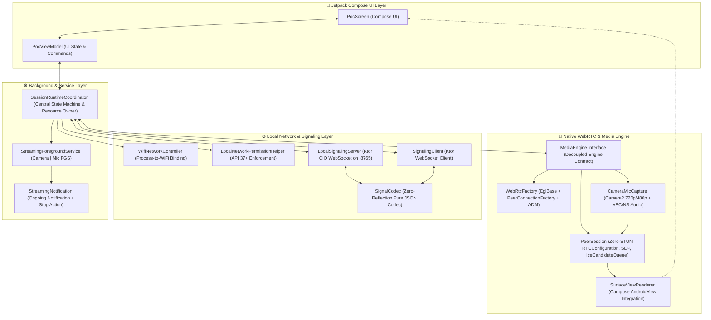
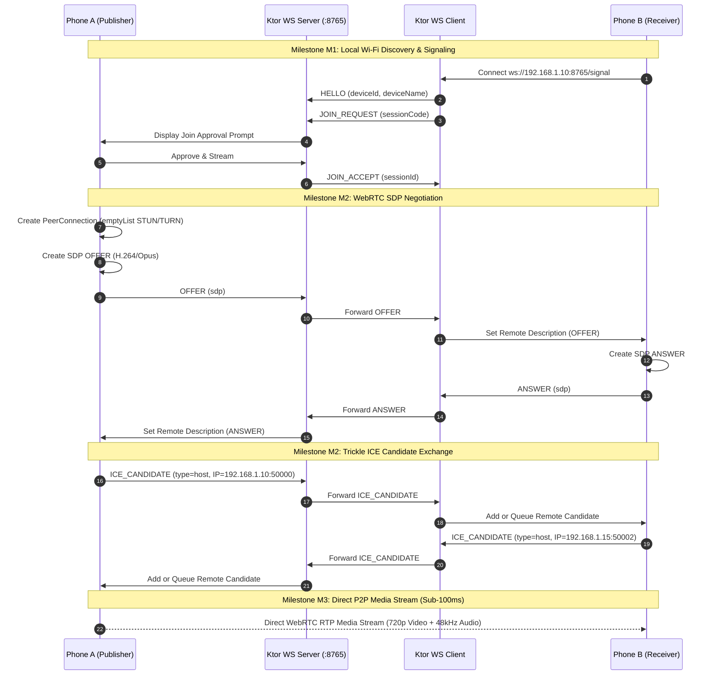

# LocalCast Architecture Guide: From Mental Model to Native WebRTC

Welcome to the comprehensive architecture guide for **LocalCast**. This document explains how LocalCast achieves ultra-low-latency, peer-to-peer (P2P), completely offline audio/video streaming directly between two Android devices over a local Wi-Fi network.

Whether you are a beginner looking to understand real-time streaming or preparing to present this project to teammates or interviewers, this guide breaks down every milestone (M0 through M4) with plain-English analogies, concrete code patterns, and interactive diagrams.

---

## 1. The Core Mental Model: How LocalCast Works

To understand WebRTC and signaling without getting lost in technical jargon, consider this real-world analogy:

> [!NOTE]
> ### 🏨 The Hotel Intercom Analogy
> Imagine two people, **Alice (Phone A - Host)** and **Bob (Phone B - Receiver)**, staying in separate rooms in the same hotel.
> 1. **The Signaling Channel (M1):** Alice and Bob pick up their bedside landline phones to call the hotel front desk. Alice says, *"I'm in Room 101."* Bob says, *"I want to talk to Alice in Room 101."* The front desk coordinates their room numbers and approves Bob's call. This is **Signaling**—it exchanges connection information, but no video travels across this line.
> 2. **The SDP Contract (M2):** Over the landline, Alice writes down a list of what formats she can speak (*"I can send 720p H.264 video and 48kHz Opus audio"*) and sends that note to Bob. Bob replies (*"I accept H.264 and Opus"*). This note exchange is the **SDP Offer/Answer**.
> 3. **The ICE Addresses (M2):** Both check their exact local addresses within the hotel (*"Walk down Hallway B, third door on the left"*). They exchange these slips of paper (**ICE Candidates**).
> 4. **The Direct Media Stream (M3):** Once they know each other's exact room location and agreed media format, they open their hallway doors and stream directly between each other with walkie-talkies. The front desk phone is hung up! This is **Peer-to-Peer WebRTC**.

---

## 2. High-Level System Architecture

LocalCast is architected around a strict separation of concerns: UI, Runtime Service Management, Signaling, and the Native WebRTC Engine.



---

## 3. Milestones Deep Dive (M0 through M4)

### Milestone M0: Native WebRTC Core & Initialization

**Primary Classes:** [`MediaEngine.kt`](file:///d:/LocalCast/app/src/main/java/com/localcast/poc/rtc/MediaEngine.kt), [`WebRtcFactory.kt`](file:///d:/LocalCast/app/src/main/java/com/localcast/poc/rtc/WebRtcFactory.kt)

#### The Goal
Initialize Google's native WebRTC C++ binaries on Android without crashing, establish an OpenGL graphics context for GPU-accelerated video rendering, and isolate WebRTC behind an interface.

#### Key Architectural Components
1. **Interface Isolation (`MediaEngine`):** UI and services never interact with Google WebRTC's C++ classes (`PeerConnection`, `VideoTrack`, etc.) directly. All WebRTC operations are decoupled behind the pure Kotlin `MediaEngine` interface.
2. **OpenGL Context (`EglBase.create()`):** WebRTC captures, crops, scales, and renders video frames using GPU texture buffers. An `EglBase` context manages shared EGL display resources across camera capturers and video sinks.
3. **Hardware Audio Engine (`JavaAudioDeviceModule`):** Initializes native Android audio record and play tracks with hardware Acoustic Echo Cancellation (AEC) and Noise Suppression (NS).
4. **PeerConnectionFactory:** The native C++ factory responsible for creating peer connections, audio tracks, and video tracks.

---

### Milestone M1: Wi-Fi Process Binding & Local Signaling

**Primary Classes:** [`WifiNetworkController.kt`](file:///d:/LocalCast/app/src/main/java/com/localcast/poc/network/WifiNetworkController.kt), [`LocalNetworkPermissionHelper.kt`](file:///d:/LocalCast/app/src/main/java/com/localcast/poc/network/LocalNetworkPermissionHelper.kt), [`LocalSignalingServer.kt`](file:///d:/LocalCast/app/src/main/java/com/localcast/poc/signaling/LocalSignalingServer.kt), [`SignalingClient.kt`](file:///d:/LocalCast/app/src/main/java/com/localcast/poc/signaling/SignalingClient.kt), [`SignalCodec.kt`](file:///d:/LocalCast/app/src/main/java/com/localcast/poc/signaling/SignalCodec.kt)

#### The Goal
Connect two devices on the same local Wi-Fi network without requiring internet access, routers with WAN connections, or cloud servers.

#### Key Architectural Components
1. **Wi-Fi Process Binding:** Android devices with cellular data frequently route local LAN packets through mobile data if the Wi-Fi has "No Internet Access". LocalCast calls `ConnectivityManager.bindProcessToNetwork(wifiNetwork)` so all socket traffic is strictly pinned to the local Wi-Fi interface.
2. **Conditional Android 17 (API 37) Permissions:** Google introduced `android.permission.ACCESS_LOCAL_NETWORK` in Android 17. LocalCast uses `LocalNetworkPermissionHelper` to enforce runtime permission checks on API 37+ while remaining fully compatible with Android 10 through 16 (API 29–36).
3. **Embedded WebSocket Signaling (Port 8765):**
   - **Host (Phone A):** Runs an embedded Ktor CIO WebSocket server listening on `ws://<Local_IP>:8765/signal`.
   - **Receiver (Phone B):** Connects as a Ktor WebSocket client.
4. **Zero-Reflection `SignalCodec`:** Standard reflection-based JSON libraries (Jackson, Gson) add binary bloat and slow down frame parsing. LocalCast implements a high-performance pure-Kotlin JSON tokenizer and serializer that handles multiline WebRTC SDP text (`\r\n`) cleanly.

#### Signaling Protocol Frame Types
```text
HELLO          -> Phone B broadcasts its presence and device name to Phone A
JOIN_REQUEST   -> Phone B asks to connect with session join code
JOIN_ACCEPT    -> Phone A approves Phone B's connection request
JOIN_REJECT    -> Phone A rejects the connection request
OFFER          -> Phone A sends its WebRTC SDP Offer
ANSWER         -> Phone B returns its WebRTC SDP Answer
ICE_CANDIDATE  -> Trickled local IP/port candidates exchanged asynchronously
TRACK_STATE    -> Synchronizes camera mute / microphone mute state in real-time
PING / PONG    -> Round-trip time (RTT) telemetry and connection heartbeat
BYE            -> Graceful session termination
```

---

### Milestone M2: WebRTC Offer/Answer & Local ICE Gathering

**Primary Classes:** [`PeerSession.kt`](file:///d:/LocalCast/app/src/main/java/com/localcast/poc/rtc/PeerSession.kt), [`RtcObserver.kt`](file:///d:/LocalCast/app/src/main/java/com/localcast/poc/rtc/RtcObserver.kt)

#### The Goal
Establish a direct P2P audio/video stream between the two phones without any third-party relay or public internet traversal.



#### Key Architectural Decisions in M2
1. **Zero STUN/TURN Servers (`RTCConfiguration(emptyList())`):** Standard WebRTC tutorials use Google's public STUN servers (`stun:stun.l.google.com:19302`). In LocalCast, because operation is strictly local LAN and offline, configuring STUN would cause connection timeouts when internet is disconnected. Passing an empty list enforces **strictly local `host` ICE candidates**.
2. **`IceCandidateQueue` (Preventing Race Conditions):** In WebRTC, ICE candidates are generated asynchronously (trickled) while the SDP Offer/Answer is still being negotiated. If a candidate arrives before `setRemoteDescription` completes, the native C++ engine throws an error. `IceCandidateQueue` safely queues early candidates in FIFO order and flushes them the instant remote description is applied.

---

### Milestone M3: Camera2 & Microphone Pipeline

**Primary Classes:** [`CameraMicCapture.kt`](file:///d:/LocalCast/app/src/main/java/com/localcast/poc/capture/CameraMicCapture.kt), [`PocScreen.kt`](file:///d:/LocalCast/app/src/main/java/com/localcast/poc/ui/PocScreen.kt)

#### The Goal
Capture low-latency camera video and microphone audio with hardware acceleration and render it smoothly inside modern Jetpack Compose UI.

#### The Video Capture & Fallback Engine
- **Target Resolution:** **720p @ 30 FPS** (`1280x720`).
- **Hardware Fallback:** If an older budget Android camera sensor rejects 720p capture, `CameraMicCapture` automatically catches the exception and falls back to **480p @ 30 FPS** (`640x480`).
- **SurfaceTextureHelper:** Uses zero-copy GPU textures to deliver frames straight to WebRTC's native hardware video encoder (H.264 / VP8) without CPU memory copying.
- **Dynamic Controls:**
  - Front/Rear camera switching (`switchCamera()`).
  - Independent track muting (`toggleCamera()`, `toggleMicrophone()`) synchronized to the receiver using `TRACK_STATE` signaling.

#### Jetpack Compose UI Integration
Google WebRTC's video renderer is an Android View called `SurfaceViewRenderer`. Jetpack Compose cannot host native Android Views directly, so LocalCast wraps it in an `AndroidView` composable with a `DisposableEffect` that handles initialization and releases EGL surfaces when the composable leaves the screen:

```kotlin
AndroidView(
    factory = { ctx ->
        SurfaceViewRenderer(ctx).apply {
            init(eglBaseContext, null)
            setScalingType(RendererCommon.ScalingType.SCALE_ASPECT_FIT)
            setEnableHardwareScaler(true)
            mediaEngine.attachLocalSink(this)
        }
    },
    update = { /* UI recomposition updates */ }
)
```

---

### Milestone M4: Background Streaming & Foreground Service

**Primary Classes:** [`StreamingForegroundService.kt`](file:///d:/LocalCast/app/src/main/java/com/localcast/poc/service/StreamingForegroundService.kt), [`StreamingNotification.kt`](file:///d:/LocalCast/app/src/main/java/com/localcast/poc/service/StreamingNotification.kt), [`SessionRuntimeCoordinator.kt`](file:///d:/LocalCast/app/src/main/java/com/localcast/poc/service/SessionRuntimeCoordinator.kt)

#### The Goal
Ensure the stream continues without dropping frames when the user minimizes the app, presses the Android Home button, or switches to another app.

#### Why This Matters
Android aggressively terminates background processes to conserve battery and RAM. Furthermore, Android 14+ (API 34+) strictly forbids apps from accessing the camera or microphone from the background unless managed by a **Foreground Service** with explicit foreground service types.

#### The Architectural Solution
1. **`SessionRuntimeCoordinator` as Process Singleton:** All active WebRTC peer sessions, camera capturers, and Ktor sockets live inside `SessionRuntimeCoordinator`, decoupled from `MainActivity`'s lifecycle.
2. **`StreamingForegroundService`:** Declared in `AndroidManifest.xml` with `android:foregroundServiceType="camera|microphone"`.
3. **Ongoing Notification:** Displays persistent streaming telemetry (duration, RTT latency, frames streamed) with an immediate **Stop Sharing** action button.
4. **Clean Resource Teardown:** Tapping "Stop Sharing" cleanly unbinds the Wi-Fi network, disposes the camera capturer, closes WebRTC transceivers, terminates Ktor sockets, and dismisses the foreground notification with zero memory leaks.

---

## 4. Summary Table of Key Classes

| Package | Class | Responsibility |
|---|---|---|
| `rtc` | [`MediaEngine`](file:///d:/LocalCast/app/src/main/java/com/localcast/poc/rtc/MediaEngine.kt) | Core interface isolating WebRTC from Android UI |
| `rtc` | [`WebRtcFactory`](file:///d:/LocalCast/app/src/main/java/com/localcast/poc/rtc/WebRtcFactory.kt) | Initializes `PeerConnectionFactory`, `EglBase`, and audio modules |
| `rtc` | [`PeerSession`](file:///d:/LocalCast/app/src/main/java/com/localcast/poc/rtc/PeerSession.kt) | Manages native `PeerConnection`, SDP negotiation, and ICE candidate queue |
| `capture` | [`CameraMicCapture`](file:///d:/LocalCast/app/src/main/java/com/localcast/poc/capture/CameraMicCapture.kt) | Camera2 capturer with 720p/480p fallback and front/back toggle |
| `network` | [`WifiNetworkController`](file:///d:/LocalCast/app/src/main/java/com/localcast/poc/network/WifiNetworkController.kt) | Binds socket traffic to the Wi-Fi interface via Android `ConnectivityManager` |
| `network` | [`LocalNetworkPermissionHelper`](file:///d:/LocalCast/app/src/main/java/com/localcast/poc/network/LocalNetworkPermissionHelper.kt) | Handles conditional `ACCESS_LOCAL_NETWORK` for Android 17 (API 37+) |
| `signaling` | [`LocalSignalingServer`](file:///d:/LocalCast/app/src/main/java/com/localcast/poc/signaling/LocalSignalingServer.kt) | Embedded Ktor CIO WebSocket server on port 8765 |
| `signaling` | [`SignalingClient`](file:///d:/LocalCast/app/src/main/java/com/localcast/poc/signaling/SignalingClient.kt) | Ktor WebSocket client for receiver devices |
| `signaling` | [`SignalCodec`](file:///d:/LocalCast/app/src/main/java/com/localcast/poc/signaling/SignalCodec.kt) | Zero-reflection pure-Kotlin JSON parser and serializer |
| `service` | [`SessionRuntimeCoordinator`](file:///d:/LocalCast/app/src/main/java/com/localcast/poc/service/SessionRuntimeCoordinator.kt) | Central orchestrator owning session state across Activity lifecycles |
| `service` | [`StreamingForegroundService`](file:///d:/LocalCast/app/src/main/java/com/localcast/poc/service/StreamingForegroundService.kt) | Manages ongoing foreground camera/mic service execution |
| `ui` | [`PocScreen`](file:///d:/LocalCast/app/src/main/java/com/localcast/poc/ui/PocScreen.kt) | Jetpack Compose UI hosting video viewports and telemetry cards |
